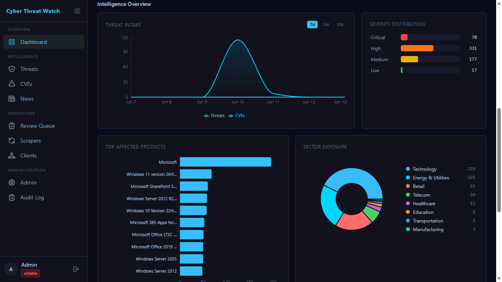
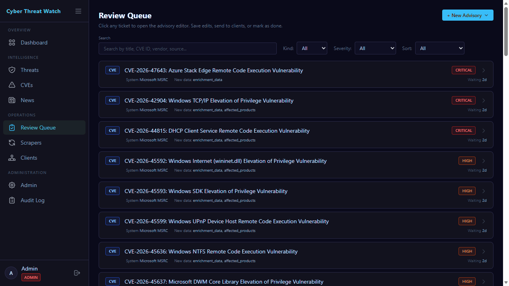
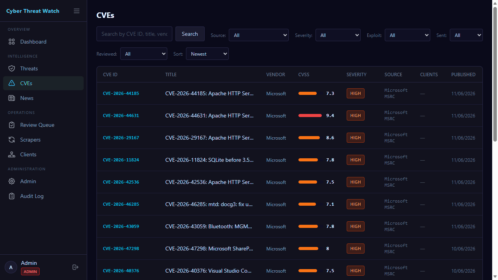
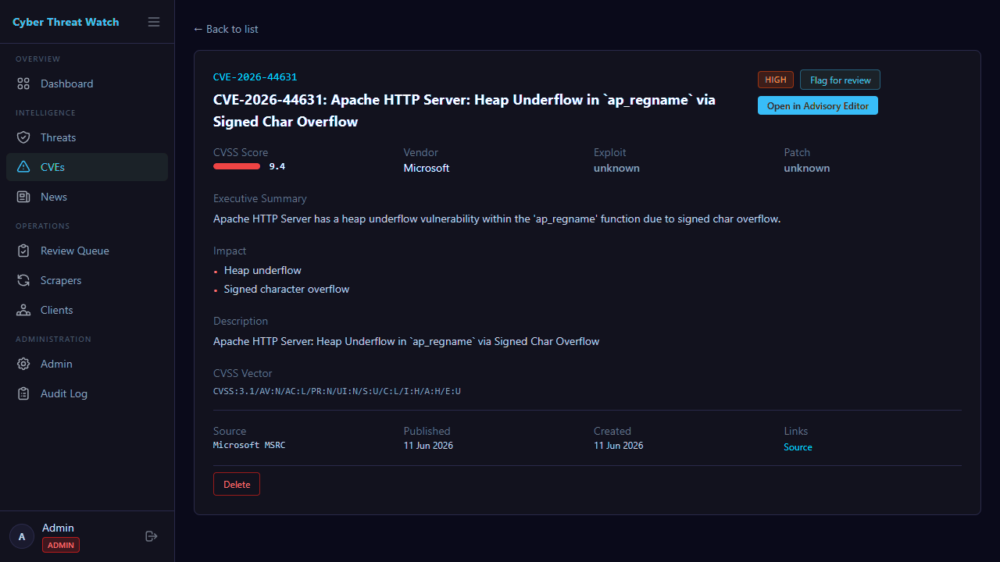
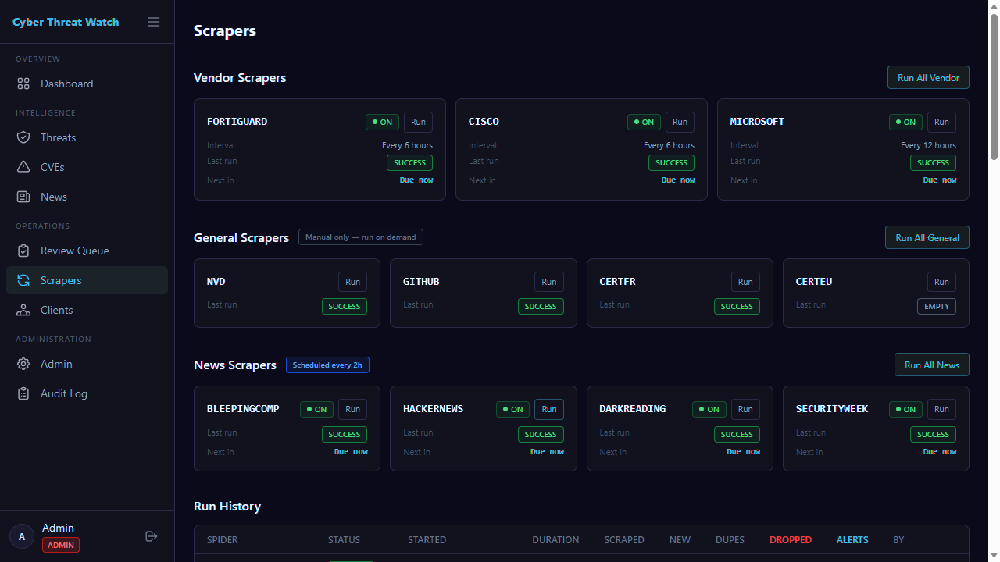

# Cyber Threat Watch

A threat-intelligence and vulnerability-advisory platform. It collects CVEs, vendor advisories and
security news, enriches them with NLP and a local language model, identifies which clients are
affected based on their asset inventories, and gives analysts a workflow to review and send
security advisories.

I developed this platform during my end-of-studies internship (2026). This repository is a
de-branded version of the code: organisation-specific branding, email templates and deployment
configuration have been removed.

## Features

- **Collection** from 11 public sources with scheduled Scrapy spiders (some using Playwright):
  NVD, GitHub Security Advisories, CERT-FR, CERT-EU, Microsoft, Cisco, FortiGuard, The Hacker News,
  BleepingComputer, SecurityWeek and Dark Reading.
- **Processing pipeline** for each item: validation, NLP classification, risk scoring, LLM enrichment
  and storage.
- **NLP classification** with [TTPXHunter](https://huggingface.co/nanda-rani/TTPXHunter)
  (SecureBERT fine-tuned) to map threat reports to MITRE ATT&CK techniques, plus detection of
  active exploitation.
- **LLM enrichment** with a local model served by Ollama (phi3.5), which extracts affected products,
  impacts, remediation and mitigations, and translates French advisories to English. The model choice
  is documented in [`evaluation/llm-extraction`](evaluation/llm-extraction).
- **Client exposure matching**: each CVE is matched against client asset inventories
  (vendor, product, version range) imported from Excel.
- **Analyst workflow**: review queue, enrichment proposals that an analyst must approve, advisory
  editor, email distribution, PDF reports and a full audit log.
- **Roles**: administrators, analysts, and read-only client accounts that only see their own exposure.
- **Security**: JWT access and refresh tokens with type checking, bcrypt, role-based access on every
  endpoint, login rate limiting, tenant data redaction for client accounts, security headers, and a
  start-up check that refuses weak secrets in production.

## Screenshots

**Dashboard:** intake over time, severity distribution, most affected products and sector exposure.



**Review queue:** items with new enrichment waiting for an analyst.



**CVE list and detail**





**Scrapers:** schedule, status and run history of each source.



## Architecture

| Service | Technology | Role |
|---|---|---|
| `backend` | FastAPI (Python 3.12), SQLAlchemy async | REST API |
| `frontend` | React 18, Tailwind CSS, Recharts | Analyst dashboard and client portal |
| `postgres` | PostgreSQL 16 | Data store |
| `redis` | Redis 7 | Celery broker, cache, rate limiter, locks |
| `celery-worker` | Celery, Scrapy, Transformers | Spiders, NLP and enrichment |
| `celery-beat` | Celery Beat | Scheduling (vendor sources every 6 hours, news every 2 hours) |
| `mailpit` | Mailpit | Development mail catcher |

Ollama runs on the host so the model can use the GPU.

```
backend/
  app/api/          REST endpoints (auth, cves, threats, news, proposals, advisory, reports, ...)
  app/models/       SQLAlchemy models
  app/services/     NLP classifier, enrichment, matching engine, email, inventory parser
  app/tasks/        Celery tasks and schedule
  scraper/spiders/  One spider per source
  templates/        Email and PDF templates
frontend/src/
  pages/            Dashboard, CVEs, threats, news, review queue, clients, scrapers, admin
  components/       Charts, review and advisory editor, report editor, UI components
```

## Running locally

Requirements: Docker with Docker Compose, and [Ollama](https://ollama.com) with the model pulled
(`ollama pull phi3.5`). A GPU is recommended for the NLP and LLM steps.

```bash
cp .env.example .env
# set ENVIRONMENT=development and fill in DB_PASSWORD, REDIS_PASSWORD, REDIS_URL and SECRET_KEY
docker compose up --build
```

- Frontend: http://localhost:3000
- API documentation: http://localhost:8000/docs (development only)
- Mailpit: http://localhost:8025

In development, three accounts (admin, analyst, client) are created on first start with random
passwords, which are printed once in the backend log. In production, create the first administrator
with `INITIAL_ADMIN_EMAIL` / `INITIAL_ADMIN_PASSWORD` or `python scripts/create_admin.py`.

## Notes

- The TTPXHunter model and its label files come from the
  [TTPXHunter project](https://github.com/nanda-rani/TTPXHunter-Actionable-Threat-Intelligence-Extraction-as-TTPs-from-Finished-Cyber-Threat-Reports).
- Enrichment output is treated as untrusted: nothing generated by the model is sent to a client
  without an analyst's approval.
